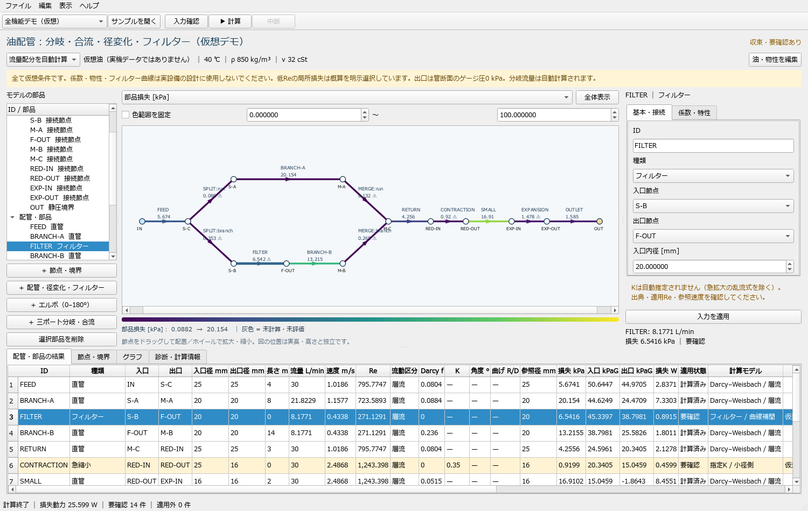

# 油配管の圧力損失アプリ

Windows向けの日本語デスクトップアプリ（初版）。定常・単相・非圧縮・ニュートン流体の油を、一定の温度・密度・粘度で計算します。



## 起動

WindowsにPython 3.12以降を用意し、GitHubからこのリポジトリを取得・展開してください。
このフォルダーでPowerShellから次を実行します。

```powershell
.\setup.ps1
.\start.bat
```

初回設定後は `start.bat` のダブルクリックでも起動できます。アプリ専用の `.venv` を使用します。
PowerShellでスクリプトの実行が制限されている場合は、手動で仮想環境と依存パッケージを準備できます。

```powershell
python -m venv .venv
.\.venv\Scripts\python.exe -m pip install -r requirements.txt
.\start.bat
```

ソースを動かす形式です。Python不要のEXEはまだ作成していません。
開発・検証時の依存バージョンは `requirements-lock.txt` に記録しています。
個人のモデル、計算出力、仮想環境、CADファイルは公開対象に含めません。サンプルは `examples/` の仮想条件だけです。

Creo / STEPからのCAD取り込みは検討段階で、現時点では未実装です。計画は [CREO_IMPORT_PLAN.md](CREO_IMPORT_PLAN.md) を参照してください。

## 最初に試す手順

エルボ追加（2026-10-24）：左の「＋ エルボ（0–180°）」から丸形・同径エルボを追加できます。角度と中心線曲げ半径比R/Dを入力してKを自動計算する方式と、実測等のKを入力する方式があります。詳しくは `ELBOW_MODEL.md` を参照してください。

1. 起動時は「全機能デモ（仮想）」が開きます。「▶ 計算」を押します。
2. 系統図の上で「部品損失」「流量」「入口静圧」などを選び、色の凡例を確認します。
3. 部品を図か左の一覧で選ぶと、右に入力、下に結果が表示されます。
4. 内径・長さ・K・接続などを変更し「入力を適用」。結果が消えるので再計算します。
5. 下の「グラフ」で経路圧力、部品別損失、フィルター特性を切り替えます。開始・経由・終点の節点で通る枝を選べます。
6. 「ファイル」でモデルJSONの保存、結果CSV、図・グラフPNGの出力ができます。

デモの油物性・寸法・K・フィルター曲線は全て仮想です。実設備の設計値ではありません。
実機に使う場合は、使用温度での密度・動粘度、実寸法、メーカー特性、適用根拠のある係数へ置き換えてください。

## 自分のモデルを作る

「ファイル → 新規」で空のモデルを作成します。

- 節点を追加し、入口を「流量境界」、出口を「静圧境界」にします。入口は外部から注入する流量を正、外部へ流出させる指定は負です。
- 静圧境界はゲージ静圧[kPaG]です。境界内径を接続管と同じにすれば、管断面での静圧を指定できます。
- 境界内径0はタンク等の速度ゼロの基準です。接続部の入口/出口損失は自動付加されません。必要なら汎用K部品を追加してください。
- 接続節点を配置し、その間に直管・径変化・フィルター等を追加します。入口/出口はIDの選択で変更できます。
- 図の節点はドラッグで動かせます。図の長さと実際の直管長・高さは独立です。実高さは節点の「実際の高さ」で入力します。
- 分岐・合流は三ポート部品を追加します。共通側、直進側、側枝側にそれぞれ別の節点を割り当て、外側の配管を接続します。
- 3本の管を同じ節点へ直接つなぐ方法は使いません。分岐・合流の損失を明示的に定義するためです。
- 接続ポートの内径は合わせてください。内径が変わる場所には急拡大または急縮小を挿入します。
- 「編集 → 元に戻す/やり直し」に対応します。接続中の節点は接続を解除してから削除します。

右のフォームを変更した後は「入力を適用」を押します。別の部品選択・保存・計算・出力時にも自動適用します。
適用後は旧結果を無効にし、再計算を求めます。配置だけの変更では計算値を保持します。

## 二つの計算モード

### 流量配分を自動計算

入口の総流量と出口の静圧を指定し、枝流量と必要な供給圧力を求めます。
複数の静圧境界から流量を求める計算もできます。
分岐・合流のKはユーザー指定値を固定して使用します。流量比でKが変わる詳細相関の自動反復は未実装です。

### 全枝の流量を指定

各配管・部品の「指定モードの流量」と、分岐・合流の「指定直進流量」「指定側枝流量」を入力します。
流量境界との連続式およびループの圧力収支を検査します。矛盾する流量を強制的に成立したものとして表示しません。
仮想の全機能デモの18/12 L/minは手入力例なので、そのまま指定モードに切り替えると圧力収支が不整合になります。
指定モードを試すには「対称分岐・合流の検算」サンプルを使ってください。

## 計算モデル

- 円管直管：Darcy–Weisbach。層流は64/Re、乱流はColebrook–White。Darcy係数に統一します。
- Re 2300–4000：摩擦係数と断面の運動エネルギー補正係数を補間し、遷移域として表示します。
- 接点の未知量：静圧＋α×動圧＋位置エネルギー圧。αは発達層流2、乱流1、遷移域は補間。
- 静圧は各ポートの実流速から逆算します。分岐の共通側には二経路の合計流量を使います。
- 急拡大：K空欄ならBorda–Carnot（小径側速度基準）。低Reでは標準で適用外。「概算を許可」を選んだ場合のみ注意付きで表示。
- 急縮小・汎用抵抗：入力K。急縮小は小径側速度、汎用Kは指定参照径。
- エルボ：0–180度、R/D > 0.5 の丸形・同径。Rennels式による自動K、または入力角度に対する指定K。自動Kは曲管摩擦込み。低Re・粗面は標準で適用外、明示選択時のみ概算。結果表・CSVに角度とR/Dを併記します。
- 分岐・合流：経路別K。基準は「共通側流速」または「各経路側流速」を明示選択。
- 経路Kは負の値も入力可能ですが、三ポート部品全体の損失動力が負になる条件は適用外にします。
- フィルター：Q–差圧の線形補間、または一つの運転点の指定差圧。曲線の基準粘度と現在の動粘度が異なる場合は適用外です。
- フィルターの粘度補正、ハウジング/エレメント分離、閉塞自動予測、バイパス流量の自動計算は未実装です。
- フィルター曲線外や指定差圧の運転流量不一致は適用外です。計算反復中の仮の外挿を最終結果として採用しません。
- 内径入力はmm、長さm、流量L/min、動粘度cSt、圧力kPa。内部計算はSIです。

数値解法はSciPyの非線形最小二乗。流量と圧力をスケーリングし、最大無次元残差1e-6以下を収束条件にします。
初版は節点200個、内部計算枝500本まで。性能を保証する規模ではありません。

理論式と一次資料の一覧は `RESEARCH_AND_PLAN.md` を参照してください。

## 結果の読み方

- 「収束」は数値方程式の収束です。モデルの適用可否・実測との一致を意味しません。
- 黄色の表行は低Re、概算係数、助走長などの要確認項目、赤い行は適用外です。
- 適用外の部品の色は灰色・破線です。未設定Kは計算内部で仮にゼロとして残差を求めますが、結果全体は適用外になり、ゼロ損失が確認されたとは扱いません。
- 静圧差と不可逆損失は異なります。径変化では流速変化、高さの違いでは位置エネルギーも静圧差に影響します。
- 局所全圧は静圧＋α×動圧で表示します。グラフの圧力はゲージ値です。蒸気圧・キャビテーション余裕の判定は未実装です。
- 表の速度は、直管では管内速度、K部品・三ポート経路では損失係数の参照速度です。参照内径も併記します。
- 全枝の損失[kPa]は合計しません。ネットワーク全体の損失はΣQΔpの動力[W]と境界エネルギー収支で確認します。
- 各経路の累積損失は経路グラフで確認します。集中抵抗は実長ゼロの段差です。
- CSVには仮想条件の注記・適用状態・各部品のモデルと出典・診断を含めます。

## 検証と制限

検証実行：

    .\.venv\Scripts\python.exe -m unittest test_engine test_ui -v

GUIを使わない計算：

    .\.venv\Scripts\python.exe main.py examples\full_demo.json --solve

Pythonの自動検算、画面のオフスクリーン描画、実際のWindowsでの手動操作、実機配管との照合は別の検証です。
実施済みの範囲は `VERIFICATION.md` に記録します。

初版対象外：水撃・脈動、熱収支と管路内の温度変化、非ニュートン流体、圧縮性、混相、ポンプ性能曲線、詳細分岐相関の自動K、低Re部品の自動補正、油種データベース、内径自動最適化、PDF報告書、独立したケース比較画面。
複数条件はモデルを別名保存して比較できますが、自動パラメータ掃引は未実装です。
原典の局所抵抗相関とこのエネルギー定義が整合することを確認してKを入力してください。
